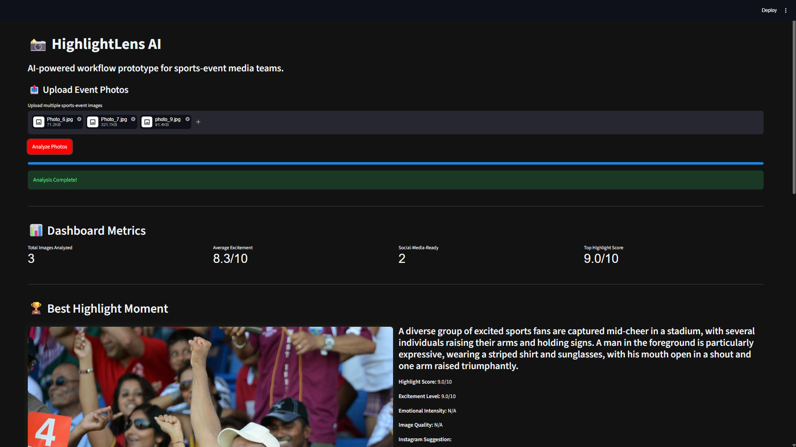
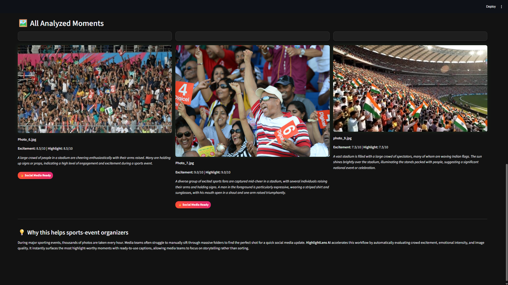

# 📸 HighlightLens AI

**AI-powered workflow prototype for sports-event media teams.**

During major sporting events, thousands of photos are taken every hour. Media teams often struggle to manually sift through massive folders to find the perfect shot for a quick social media update. 

**HighlightLens AI** accelerates this workflow by automatically evaluating crowd excitement, emotional intensity, and image quality using Google's Gemini Vision AI. It instantly surfaces the most highlight-worthy moments with ready-to-use captions, allowing media teams to focus on storytelling rather than sorting.

---

## ✨ Features

- **🧠 Advanced AI Vision Engine:** Powered by `gemini-2.5-flash` to extract facial metrics, crowd density, and emotional peaks from photos.
- **🏆 Dynamic Ranking System:** Automatically sorts and ranks the best highlights with a custom excitement score.
- **📊 Presentation Mode:** Enter a futuristic, dark-mode presentation view to showcase the best moments on a big screen.
- **🏷️ Reasoning Tags & Recommendations:** The AI tags photos (e.g. `#emotional_peak`, `#celebration`) and recommends the best platform for the shot (Instagram, Broadcast, etc).
- **📉 AI Confidence Meters:** Visual score bars representing the AI's confidence and highlight metrics.

---

## 🖼️ Application Previews

Here are some previews of the HighlightLens AI in action:

### The Dashboard


### Presentation Mode



---

## 🚀 Running Locally

1. **Clone the repository**
   ```bash
   git clone https://github.com/tkacha467/highlightlens-ai.git
   cd highlightlens-ai
   ```

2. **Install requirements**
   ```bash
   pip install -r requirements.txt
   ```

3. **Set up your API Key**
   Create a `.env` file in the root folder and add your Google Gemini API key:
   ```env
   GEMINI_API_KEY=your_api_key_here
   ```

4. **Run the App**
   ```bash
   streamlit run app.py
   ```

---
*Built for modern sports media workflows.*
